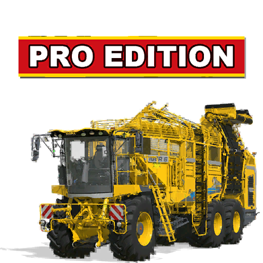

# ModHub upload: Ropa Tiger 6S ProEdition

What to enter in the GIANTS ModHub upload form for this mod. Each text box below has a copy button on GitHub.



**Mod Icon (512x512):** [`icon_512.png`](icon_512.png)

| Field | Value |
|-------|-------|
| Title English | Ropa Tiger 6S ProEdition |
| Title German | Ropa Tiger 6S ProEdition |
| Title French | Ropa Tiger 6S ProEdition |
| Version | `1` `2` `1` `1` |
| Author | DTM Mods, PropaineX |
| Manufacturer | Ropa |
| Category 1 | Rootcrops > Beet Harvesters |
| Category 2 | Rootcrops > Beet Harvester Headers |
| Category 3 | Vegetables > Vegetable Harvesters |

## Title English
```text
Ropa Tiger 6S ProEdition
```

## Title German
```text
Ropa Tiger 6S ProEdition
```

## Title French
```text
Ropa Tiger 6S ProEdition
```

## Description English
```text
Tiger 6S ProEdition
Category: Beet Harvesters
Price: $699,000
Power: 796 hp (996 hp with the Tiger ProEdition engine)
Max. speed: 40 kph
Working speed: 15 kph
Capacity: 43,000 l (Boosted tank 57,500 l, Extreme tank 63,000 l)

RR-XL 9x45 ProEdition
Category: Beet Harvester Headers
Price: $79,000
Working width: 5.5 m
Working speed: 15 kph

RR-XL 9x45 header trailer ProEdition
Category: Beet Harvester Headers
Price: $9,000

ProEdition copies of the base-game Ropa Tiger 6S self-propelled beet harvester, its RR-XL 9x45 header and the header trailer.

The models, textures, sounds and settings are the same as the base-game machines. They are listed in the shop next to the originals.

ProEdition: the header harvests, and the Tiger holds, every root crop and vegetable in the base game, plus sugar cane: sugar beet, beetroot, potatoes, carrots, parsnips, green beans, peas, spinach, onions and sugar cane (topped and cut, with the game's cane cutting effects and cane on the belts).

Tiger shop options: three tanks (Normal 43 m³, Boosted 57.5 m³, Extreme 63 m³), the 996 hp Tiger ProEdition engine, a cab window tint (Light, Medium or Dark), the side logo and rear logo each on or off, and three colors: a main color theme, a mechanical parts color for the belts and the cleaning section, and a rim color.
Header and header trailer: the same main color theme and black color group (#1) as the Tiger, so all three machines can be themed to match; the trailer also has a rim color for its rims and hubs.

Multiplayer: every player needs the mod.
```

## Description German
```text
Tiger 6S ProEdition
Shopkategorie: Rübenroder
Preis: 699.000 €
Leistung: 796 PS (996 PS mit dem Motor Tiger ProEdition)
Höchstgeschwindigkeit: 40 km/h
Arbeitsgeschwindigkeit: 15 km/h
Kapazität: 43.000 l (Bunker Boosted 57.500 l, Bunker Extreme 63.000 l)

RR-XL 9x45 ProEdition
Shopkategorie: Rübenroder-Schneidwerke
Preis: 79.000 €
Arbeitsbreite: 5,5 m
Arbeitsgeschwindigkeit: 15 km/h

RR-XL 9x45 Schneidwerkswagen ProEdition
Shopkategorie: Rübenroder-Schneidwerke
Preis: 9.000 €

ProEdition-Kopien des selbstfahrenden Rübenroders Ropa Tiger 6S aus dem Grundspiel, seines Schneidwerks RR-XL 9x45 und des Schneidwerkswagens.

Modelle, Texturen, Sounds und Einstellungen sind dieselben wie bei den Maschinen aus dem Grundspiel. Im Shop stehen sie neben den Originalen.

ProEdition: Das Schneidwerk erntet und der Tiger fasst jede Hackfrucht und jedes Gemüse aus dem Grundspiel sowie Zuckerrohr: Zuckerrüben, Rote Bete, Kartoffeln, Karotten, Pastinaken, grüne Bohnen, Erbsen, Spinat, Zwiebeln und Zuckerrohr (geköpft und geschnitten, mit den Zuckerrohr-Schneideffekten des Spiels und Zuckerrohr auf den Bändern).

Shop-Optionen des Tiger: drei Bunker (Normal 43 m³, Boosted 57,5 m³, Extreme 63 m³), der Tiger-ProEdition-Motor mit 996 PS, eine Scheibentönung der Kabine (Light, Medium oder Dark), Seitenlogo und Hecklogo jeweils an oder aus, und drei Farben: ein Hauptfarbthema, eine Farbe für die mechanischen Teile (Bänder und Reinigungsteil) und eine Felgenfarbe.
Schneidwerk und Schneidwerkswagen: dasselbe Hauptfarbthema und dieselbe schwarze Farbgruppe (#1) wie der Tiger, sodass alle drei Maschinen farblich zusammenpassen; der Wagen hat außerdem eine Felgenfarbe für Felgen und Naben.

Multiplayer: Jeder Spieler braucht den Mod.
```

## Description French
```text
Tiger 6S ProEdition
Catégorie : Arracheuses de betteraves
Prix : 699 000 $
Puissance : 796 ch (996 ch avec le moteur Tiger ProEdition)
Vitesse max. : 40 km/h
Vitesse de travail : 15 km/h
Capacité : 43 000 l (trémie Boosted 57 500 l, trémie Extreme 63 000 l)

RR-XL 9x45 ProEdition
Catégorie : Coupes à betteraves
Prix : 79 000 $
Largeur de travail : 5,5 m
Vitesse de travail : 15 km/h

Chariot de coupe RR-XL 9x45 ProEdition
Catégorie : Coupes à betteraves
Prix : 9 000 $

Copies ProEdition de l'arracheuse automotrice Ropa Tiger 6S du jeu de base, de sa coupe RR-XL 9x45 et de son chariot de coupe.

Les modèles, textures, sons et réglages sont les mêmes que ceux des machines du jeu de base. Au magasin, elles se trouvent à côté des originaux.

ProEdition : la coupe récolte, et le Tiger contient, toutes les cultures racines et tous les légumes du jeu de base, plus la canne à sucre : betteraves sucrières, betteraves rouges, pommes de terre, carottes, panais, haricots verts, petits pois, épinards, oignons et canne à sucre (effeuillée et coupée, avec les effets de coupe de canne du jeu et la canne sur les tapis).

Options du Tiger au magasin : trois trémies (Normal 43 m³, Boosted 57,5 m³, Extreme 63 m³), le moteur Tiger ProEdition de 996 ch, une teinte des vitres de la cabine (Light, Medium ou Dark), les logos latéral et arrière activables séparément, et trois couleurs : un thème de couleur principale, une couleur pour les pièces mécaniques (tapis et nettoyage) et une couleur de jantes.
Coupe et chariot de coupe : le même thème de couleur principale et le même groupe de couleur noire (n° 1) que le Tiger, pour assortir les trois machines ; le chariot a aussi une couleur de jantes pour ses jantes et moyeux.

Multijoueur : chaque joueur a besoin du mod.
```

## Screenshots

Upload the 6 images in [`screenshots/`](screenshots/) (1600x900, unedited in-game shots) in this order: [`1.jpg`](screenshots/1.jpg), [`2.jpg`](screenshots/2.jpg), [`3.jpg`](screenshots/3.jpg), [`4.jpg`](screenshots/4.jpg), [`5.jpg`](screenshots/5.jpg), [`6.jpg`](screenshots/6.jpg).

## Before uploading

- The mod is built from the base-game Ropa Tiger 6S, RR-XL 9x45 and header trailer: their models, textures and sounds are copied into the mod. ModHub may reject copies of base-game vehicles that are not changed enough; owner's decision.
- Ropa is a real brand. It is licensed by GIANTS for the base game, but GIANTS decides whether a mod may use it under its own title ("Ropa Tiger 6S ProEdition"); be ready for that question.
- Missing translations in the mod itself: the modDesc title and description, the shop names and the shop option names (tank, engine, window tint, logos) are English only. The German/French texts here do not add them to the mod.
