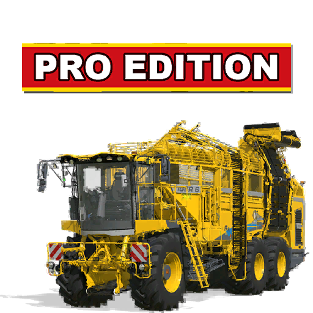

# ModHub upload: Ropa Tiger 6S ProEdition

What to enter in the GIANTS ModHub upload form for this mod. Each text box below has a copy button on GitHub.



**Mod Icon (512x512):** [`icon_512.png`](icon_512.png)

| Field | Value |
|-------|-------|
| Title English | Ropa Tiger 6S ProEdition |
| Title German | Ropa Tiger 6S ProEdition |
| Title French | Ropa Tiger 6S ProEdition |
| Version | `1` `2` `1` `1` |
| Author | DTM Mods, PropaineX |
| Manufacturer | Ropa |
| Category 1 | Rootcrops > Beet Harvesters |
| Category 2 | Rootcrops > Beet Harvester Headers |
| Category 3 | Vegetables > Vegetable Harvesters |

## Title English
```text
Ropa Tiger 6S ProEdition
```

## Title German
```text
Ropa Tiger 6S ProEdition
```

## Title French
```text
Ropa Tiger 6S ProEdition
```

## Description English
```text
ProEdition copies of the base-game Ropa Tiger 6S self-propelled beet harvester, its RR-XL 9x45 header and the header trailer, listed in the shop next to the originals. The difference is what they harvest: one machine for every root crop and vegetable, plus sugar cane.

- Harvests sugar beet, beetroot, potatoes, carrots, parsnips, green beans, peas, spinach, onions and sugar cane (with the game's cane cutting effects and cane on the belts).
- Tank: Normal (43 m³), Boosted (57.5 m³) or Extreme (63 m³); the Extreme tank can be filled with potatoes.
- Engine: the stock 796 hp Tiger 6 XL or the 996 hp Tiger ProEdition.
- Cab window tint (Light, Medium or Dark); side and rear logos on or off.
- Colors: main color theme, mechanical parts (belts and cleaning section) and rims. Header and trailer take the same main color theme, so all three match.
- Shop: Beet Harvesters (Tiger 699,000) and Beet Harvester Headers (header 79,000, trailer 9,000).
- Multiplayer: every player needs the mod.

Changelog 1.2.1.0:
- Fixed: on a server, the unloading and bunker belts sometimes kept running after unloading ended.
- They now stop for every player when the tank is empty, the engine is off or the driver gets out.
```

## Description German
```text
ProEdition-Kopien des selbstfahrenden Rübenroders Ropa Tiger 6S aus dem Grundspiel, seines Schneidwerks RR-XL 9x45 und des Schneidwerkswagens, im Shop neben den Originalen. Der Unterschied ist, was sie ernten: ein Fahrzeug für jede Hackfrucht und jedes Gemüse, dazu Zuckerrohr.

- Erntet Zuckerrüben, Rote Bete, Kartoffeln, Karotten, Pastinaken, grüne Bohnen, Erbsen, Spinat, Zwiebeln und Zuckerrohr (mit den Zuckerrohr-Effekten des Spiels und Zuckerrohr auf den Bändern).
- Bunker: Normal (43 m³), Boosted (57,5 m³) oder Extreme (63 m³); der Extreme-Bunker lässt sich mit Kartoffeln füllen.
- Motor: der serienmäßige Tiger 6 XL mit 796 PS oder der Tiger ProEdition mit 996 PS.
- Scheibentönung der Kabine (Light, Medium oder Dark); Seiten- und Hecklogo ein oder aus.
- Farben: Hauptfarbe, Mechanikteile (Bänder und Reinigung) und Felgen. Schneidwerk und Wagen nehmen dieselbe Hauptfarbe, so passen alle drei zusammen.
- Shop: Rübenroder (Tiger 699.000) und Rübenroder-Schneidwerke (Schneidwerk 79.000, Wagen 9.000).
- Mehrspieler: Jeder Spieler braucht die Mod.

Changelog 1.2.1.0:
- Behoben: Auf einem Server liefen die Entlade- und Bunkerbänder nach dem Entladen manchmal weiter.
- Sie stoppen jetzt für jeden Spieler, wenn der Bunker leer ist, der Motor aus ist oder der Fahrer aussteigt.
```

## Description French
```text
Copies ProEdition de l'arracheuse automotrice Ropa Tiger 6S du jeu de base, de sa coupe RR-XL 9x45 et de son chariot de coupe, au magasin à côté des originaux. La différence, c'est ce qu'elles récoltent : un seul véhicule pour toutes les cultures racines et tous les légumes, plus la canne à sucre.

- Récolte betteraves sucrières, betteraves rouges, pommes de terre, carottes, panais, haricots verts, petits pois, épinards, oignons et canne à sucre (avec les effets de coupe de canne du jeu et la canne sur les tapis).
- Trémie : Normal (43 m³), Boosted (57,5 m³) ou Extreme (63 m³) ; la trémie Extreme peut être remplie de pommes de terre.
- Moteur : le Tiger 6 XL d'origine de 796 ch ou le Tiger ProEdition de 996 ch.
- Teinte des vitres de la cabine (Light, Medium ou Dark) ; logos latéral et arrière activables.
- Couleurs : couleur principale, pièces mécaniques (tapis et nettoyage) et jantes. La coupe et le chariot prennent la même couleur principale, les trois sont assortis.
- Magasin : arracheuses de betteraves (Tiger 699 000) et coupes à betteraves (coupe 79 000, chariot 9 000).
- Multijoueur : chaque joueur a besoin du mod.

Changelog 1.2.1.0 :
- Corrigé : sur un serveur, les tapis de déchargement et de trémie continuaient parfois de tourner après le déchargement.
- Ils s'arrêtent maintenant pour chaque joueur quand la trémie est vide, le moteur coupé ou le conducteur descendu.
```

## Before uploading

- The mod is built from the base-game Ropa Tiger 6S, RR-XL 9x45 and header trailer: their models, textures and sounds are copied into the mod. ModHub may reject copies of base-game vehicles that are not changed enough; owner's decision.
- Ropa is a real brand. It is licensed by GIANTS for the base game, but GIANTS decides whether a mod may use it under its own title ("Ropa Tiger 6S ProEdition"); be ready for that question.
- Missing translations in the mod itself: the modDesc title and description, the shop names and the shop option names (tank, engine, window tint, logos) are English only. The German/French texts here do not add them to the mod.
